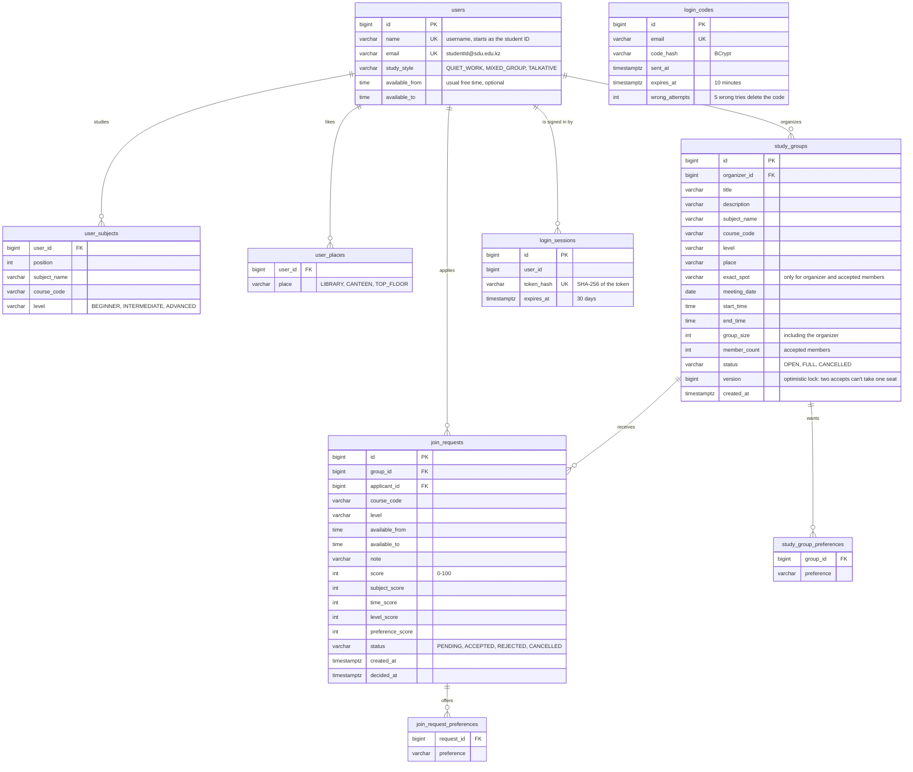

# Database: schema as built (v0.9-beta)

Hibernate creates these tables from the entities in `backend/src/main/java/com/studymate/studymate/entity/`. This replaces the Milestone 1 design ([`Database_Design.md`](Database_Design.md), [`schema.sql`](schema.sql)) as the description of the running system; those files stay as the original design record.

## Differences from the Milestone 1 design

| Milestone 1 design (`schema.sql`) | As built | Why |
| --- | --- | --- |
| `users.password_hash` | No passwords; `login_codes` and `login_sessions` | Sign-in by a code emailed to the SDU address proves the student is from SDU and leaves no password to leak |
| UUID keys | `bigint` identity keys | Hibernate default; ids are never shown to users as secrets, and every private endpoint checks the session |
| `subjects` and `preference_options` lookup tables | Course code and subject name stored as text; preferences, places and levels as fixed enum values | SDU courses are entered by code; the fixed lists live in the code and translations |
| `meeting_start` / `meeting_end` timestamps | `meeting_date` plus `start_time` / `end_time` | The form picks a day and a time slot; all times are Almaty time |
| `user_availability` with several slots | One `available_from` / `available_to` on `users` | Enough to prefill the join form for the beta |
| Score calculated, not stored | Score and its four parts stored on `join_requests` | Calculated once at applying, so the organizer sees exactly what the applicant saw |
| Partial unique indexes `one_pending_request`, `one_accepted_membership` | One index `one_active_request_per_group` on `(group_id, applicant_id)` where status is `PENDING` or `ACCEPTED`, created at start-up by `DatabaseConstraints` | Hibernate cannot create partial indexes ([#22](https://github.com/aliwer-qanadil/studymate/issues/22)) |
| — | `status` and `version` on `study_groups`, `CANCELLED` request status | Groups close when full or cancelled; the version stops two accepts from taking the last seat |

## Known gaps

- `login_sessions.user_id` has no foreign key; sessions of a deleted user simply stop working. Accounts can't be deleted in the beta.
